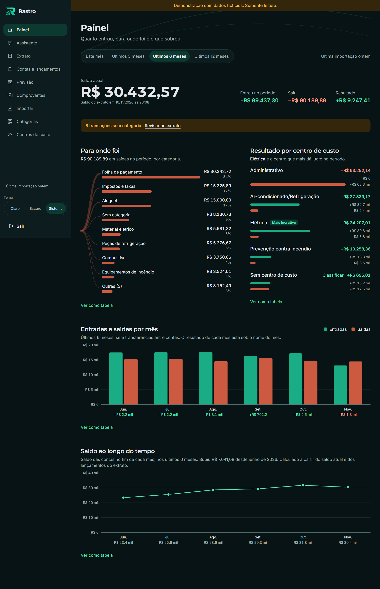
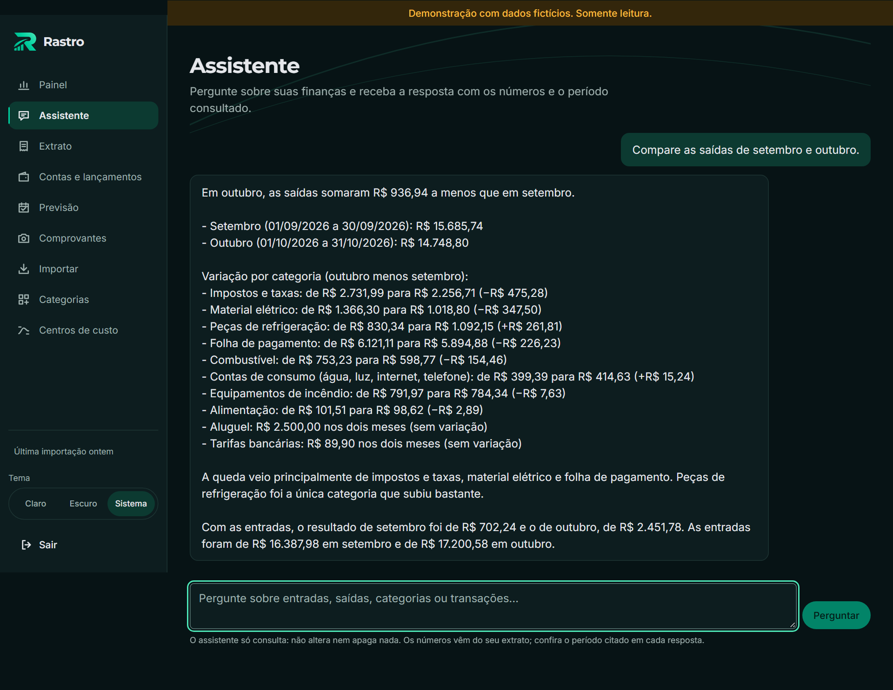
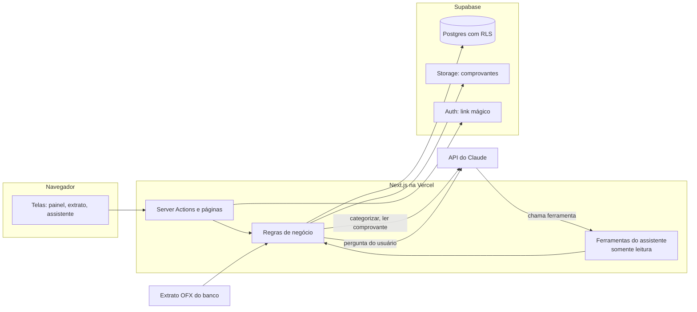

# Rastro

> Saiba para onde vai cada real.

Controle financeiro para pequenas empresas, com IA no lugar do trabalho manual: o extrato do banco entra, o Claude categoriza cada lançamento, um painel mostra para onde o dinheiro foi e um assistente responde perguntas em linguagem natural com os números do extrato.

**Demo pública (dados fictícios, sem login):** https://rastro-demo-iota.vercel.app



## O problema

A HOMETECH é uma prestadora de serviços de climatização, elétrica e prevenção contra incêndio em Palmas (TO). O financeiro era o de muita empresa pequena: comprovantes acumulando durante a semana, lançamentos digitados à mão e nenhuma resposta rápida para "quanto gastamos com material este mês?" ou "qual tipo de serviço dá mais resultado?".

## A solução

- **O extrato entra sozinho.** O arquivo OFX exportado do banco vira transações. Reimportar o mesmo período não duplica nada nem desfaz uma categoria corrigida.
- **A IA categoriza.** Regras da empresa resolvem o que é repetitivo; o Claude classifica o resto e explica a escolha em uma frase. Cada correção ensina o sistema.
- **O painel responde ao que importa.** Saldo, entradas e saídas por mês, gastos por categoria, resultado por centro de custo (ar-condicionado, elétrica, incêndio) e saldo ao longo do tempo.
- **Um assistente responde ao resto.** "Compare as saídas de setembro e outubro" devolve os números e o período consultado, sem inventar valores.
- **Comprovantes viram dados.** Foto ou PDF de Pix, boleto ou nota fiscal é lido pelo Claude e conciliado com a transação certa do extrato.

## Experimente a demo

A [demo](https://rastro-demo-iota.vercel.app) abre direto no painel de uma empresa fictícia de climatização, com seis meses de movimento. Ela é somente leitura: dá para navegar e perguntar, mas nada é gravado.

Sugestões:

1. No **Painel**, troque o período para "Últimos 6 meses".
2. No **Assistente**, pergunte "Quanto gastei com material em outubro?" ou "Quais foram os 5 maiores gastos deste mês?".
3. No **Extrato**, filtre por categoria e abra uma transação.
4. Tente criar uma categoria: a demo recusa e explica por quê.



## Como a IA é usada

### Assistente financeiro (tool use)

O assistente usa tool use do Claude com **cinco ferramentas pré-definidas e somente leitura**: resumo financeiro, gastos por categoria, comparação de períodos, maiores gastos e busca de transações.

- **O modelo nunca escreve SQL.** Ele escolhe uma ferramenta e os parâmetros; o código faz a consulta.
- **Somente leitura por construção.** As ferramentas recebem só os métodos de leitura dos serviços. Não existe caminho de escrita para o modelo chamar.
- **Mesma segurança das telas.** As consultas passam pela sessão do usuário, então o isolamento por empresa no banco (RLS) vale para o assistente.
- **Os números vêm das ferramentas.** As instruções proíbem estimar e mandam citar o período. Os totais usam as mesmas funções do painel, então a resposta bate com a tela.
- **Entrada do modelo é entrada não confiável.** Cada parâmetro é validado antes da consulta, e o texto das transações é tratado como dado, não como instrução.
- **Custo sob controle.** Limite por IP e por empresa ao dia, e teto de iterações por pergunta.

Decisão completa no [ADR 0018](documentos/arquitetura/decisoes/0018-assistente-com-ferramentas-somente-leitura.md).

### Categorização

A categorização roda em corrente, da opção mais barata para a mais cara:

1. **Regras da empresa** ("POSTO" é Combustível). Sem chamada de IA.
2. **Categoria informada pelo banco**, quando existe.
3. **Claude**, só para o que sobrou, em lotes, com saída estruturada: categoria, confiança e uma justificativa curta. Sugestões com confiança abaixo de 0,6 são descartadas.

O sistema aprende com as correções de duas formas: a correção pode virar **regra**, que passa a valer para o mesmo estabelecimento, e as correções recentes vão como **exemplos** nas chamadas seguintes ao Claude. Dados pessoais (CPF, CNPJ, e-mail, telefone, chave Pix) são mascarados antes de qualquer texto sair para a API.

Decisões nos ADRs [0003](documentos/arquitetura/decisoes/0003-strategy-categorizacao.md), [0004](documentos/arquitetura/decisoes/0004-classificador-claude.md) e [0019](documentos/arquitetura/decisoes/0019-justificativa-exemplos-e-saldo-no-tempo.md).

### Leitura de comprovantes

O Claude lê a foto ou o PDF do comprovante e devolve tipo, valor, data, emissor e itens em formato estruturado. O Rastro concilia com a transação de mesmo valor e data próxima; quando há mais de uma candidata, o usuário escolhe.

## Arquitetura



- **Camadas.** As telas falam com Server Actions, que chamam as regras de negócio em `src/regras-de-negocio/`. O acesso ao banco fica atrás de repositórios em `src/acesso-a-dados/`.
- **Isolamento por empresa.** Toda tabela tem `empresa_id` e políticas de RLS, cobertas por testes de banco.
- **Demo separada.** A demo é outro projeto na Vercel e outro banco no Supabase, só com dados fictícios. O visitante não recebe token: o servidor guarda a sessão, toda escrita é recusada no app e o banco da demo também é trancado para leitura.
- **Decisões registradas.** Dezenove ADRs em [documentos/arquitetura/decisoes/](documentos/arquitetura/decisoes/).

### Extrato: OFX hoje, Open Finance pronto

A fonte dos dados é o extrato **OFX**, formato aberto que todo banco exporta. A integração com Open Finance pela **Pluggy** também está implementada e testada (adaptador, webhook com deduplicação, sincronização diária por cron), mas fica desligada por uma variável de ambiente: em produção ela custaria no mínimo R$ 2.500 por mês, cerca de 90% do custo total do sistema. A análise está em [viabilidade.md](documentos/especificacao/viabilidade.md) e a decisão no [ADR 0016](documentos/arquitetura/decisoes/0016-extrato-ofx-e-comprovantes-com-ia.md).

## Impacto

O fechamento da semana virou uma exportação: os lançamentos acumulam no banco durante a semana e, no fim dela, um arquivo OFX é importado no Rastro. A categorização, a conciliação dos comprovantes e os totais do painel saem dali, sem digitação.

<!-- PENDENTE: tempo economizado por semana, com o número informado pelo Davi. Não estimar. -->

## Stack

- **Next.js 16** (App Router) com **TypeScript estrito** e **Tailwind CSS 4**
- **Supabase**: Postgres com RLS, Auth (link mágico) e Storage
- **Vercel**: hospedagem e cron diário
- **Claude** (API da Anthropic, modelo `claude-opus-5-5`): tool use, saída estruturada e leitura de imagens
- **Testes**: Vitest, pgTAP, Playwright com axe, Lighthouse CI e gitleaks

A ideia começou como um protótipo em Flask e React, guardado em [`prototipo-flask/`](prototipo-flask/). A versão atual foi reescrita em Next.js para ter um deploy só e tipos de ponta a ponta ([ADR 0001](documentos/arquitetura/decisoes/0001-nextjs-supabase-vercel.md)).

## Qualidade

- **316 testes de unidade** das regras de negócio e dos componentes.
- **Testes de banco em pgTAP** para RLS e funções.
- **Testes de ponta a ponta** com Playwright, incluindo acessibilidade com axe.
- **CI em todo pull request**: tipos, lint, formatação, testes, build, Lighthouse e varredura de segredos.

Detalhes em [documentos/qualidade/](documentos/qualidade/).

## Como rodar local

Pré-requisitos: Node 22.18 ou mais novo e Docker Desktop aberto (o Supabase local roda em contêineres).

```bash
npm install
cp .env.example .env.local   # preencha os valores (veja "Variáveis de ambiente")
npm run dev:completo         # sobe o Supabase local e o Next em http://localhost:3000
```

- `npm run dev:completo` roda `npx supabase start` e depois `next dev`. Ao sair (Ctrl+C) o Supabase continua no ar; para parar: `npx supabase stop`.
- As chaves do Supabase local aparecem em `npx supabase status`. Use a URL da API, a chave publicável e a chave secreta no `.env.local`.
- O banco local já vem com a empresa fictícia da demo. Para ligar o seu login a ela, veja [banco-de-dados/seeds/README.md](banco-de-dados/seeds/README.md).
- Os e-mails do link mágico chegam no Mailpit local (endereço também em `npx supabase status`).

### Testes e verificações

| Comando                | O que faz                                                         |
| ---------------------- | ----------------------------------------------------------------- |
| `npm run tipos`        | Gera os tipos de rota do Next e roda `tsc --noEmit`               |
| `npm run lint`         | ESLint                                                            |
| `npm run formatar`     | Prettier em todo o projeto (`formatar:verificar` só confere)      |
| `npm run testar`       | Testes de unidade (regras de negócio e componentes)               |
| `npm run testar:banco` | Testes pgTAP do banco (RLS, funções); precisa do Supabase local   |
| `npm run testar:e2e`   | Playwright sobre o build de produção (rode `npm run build` antes) |
| `npm run lighthouse`   | Lighthouse CI (desempenho, acessibilidade, boas práticas)         |
| `npm run segredos`     | Procura segredos vazados com o gitleaks                           |

### Variáveis de ambiente

A lista completa, sem valores, está em [.env.example](.env.example). Resumo:

- **Públicas** (vão para o navegador): `NEXT_PUBLIC_SUPABASE_URL`, `NEXT_PUBLIC_SUPABASE_PUBLISHABLE_KEY`.
- **Secretas** (só no servidor): `SUPABASE_SERVICE_ROLE_KEY`, `ANTHROPIC_API_KEY`, `CRON_SECRET`, `EMAIL_AUTORIZADO`.
- **Recursos** (0 ou 1): `RECURSO_ASSISTENTE`, `RECURSO_CATEGORIZACAO_IA`, `RECURSO_COMPROVANTES_IA`, `RECURSO_OPEN_FINANCE` e outras.
- **Demo**: `MODO_DEMO`, `DEMO_EMAIL`, `DEMO_SENHA`.

Nunca coloque valores reais no `.env.example` nem no git. O `.env.local` é ignorado pelo git.

## Deploy

- Dois projetos na Vercel seguem a branch `main`: a versão privada, com login, e a demo pública.
- As migrações do banco não rodam no deploy: são aplicadas à parte, nos dois bancos.
- O passo a passo (variáveis, migrações, demo, backup, segredos) está em [documentos/operacao.md](documentos/operacao.md).

## Documentos

- [documentos/especificacao/](documentos/especificacao/): requisitos, histórias, premissas, riscos e viabilidade
- [documentos/arquitetura/](documentos/arquitetura/): visão geral, modelo de dados, contratos e [decisões (ADRs)](documentos/arquitetura/decisoes/)
- [documentos/design/](documentos/design/): design system, fluxos, wireframes e contraste
- [documentos/qualidade/](documentos/qualidade/): plano de testes, CI e revisões
- [documentos/operacao.md](documentos/operacao.md): guia de operação
- [CHANGELOG.md](CHANGELOG.md): o que mudou em cada versão

## Sobre

Projeto de Davi Ribeiro, estudante de Engenharia de Software, feito para resolver um problema real da própria empresa. Foi desenvolvido com o Claude Code como par de programação: a especificação, as decisões de arquitetura e a revisão de cada entrega estão registradas no repositório.
