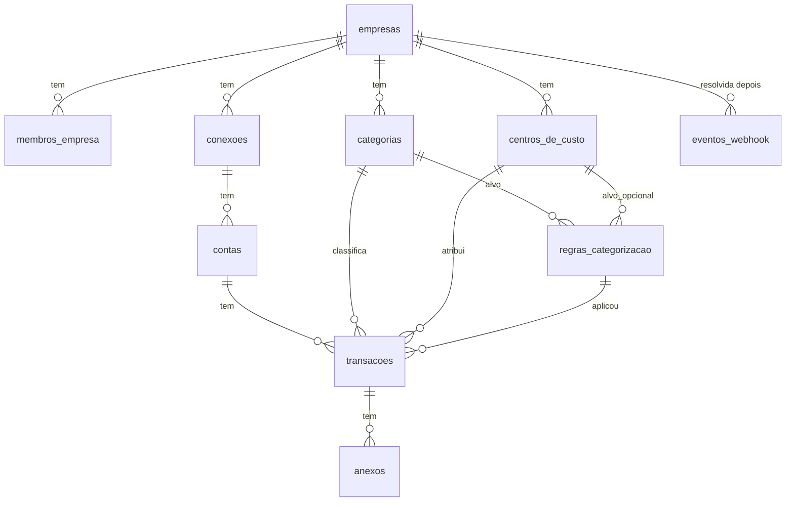

# Modelo de dados (Postgres / Supabase)

Este documento é a especificação que o **engenheiro-de-dados** implementa em `supabase/migrations/`. Os nomes seguem o [glossário](glossario.md).

## Convenções

- Chave primária `id uuid default gen_random_uuid()`, exceto em `eventos_webhook` (chave natural `event_id`) e `limites_de_requisicao`.
- Ids do agregador ficam em `id_externo text`, **nunca** como chave primária (o provedor pode mudar).
- Toda tabela de negócio tem `empresa_id uuid not null references empresas(id) on delete cascade`.
- Datas e horas em `timestamptz` (UTC). Data contábil da transação em `date`. A exibição é feita no fuso `America/Araguaina`.
- Dinheiro em `numeric(14,2)`, com **valor negativo = saída**. O TypeScript trabalha em centavos inteiros (`Centavos`), e a conversão acontece só nos repositórios e nas funções `painel_*` (que devolvem `bigint` em centavos).
- `criado_em timestamptz not null default now()`. Onde houver `atualizado_em`, existe um gatilho `definir_atualizado_em()`.
- Enumerações como `text` + `check` (mais fácil de migrar que `enum` do Postgres).
- Extensões: `pgcrypto` (já vem no Supabase) e `pg_trgm` (busca no extrato).
- Schema `privado` (não exposto pelo PostgREST) para funções auxiliares de segurança.

## Diagrama



## Tabelas

### `empresas`
| Coluna | Tipo | Regras |
|---|---|---|
| `id` | `uuid` | PK |
| `nome` | `text` | not null, `check (length(nome) between 1 and 120)` |
| `criado_em` | `timestamptz` | not null default now() |

### `membros_empresa`
| Coluna | Tipo | Regras |
|---|---|---|
| `empresa_id` | `uuid` | FK `empresas` on delete cascade |
| `user_id` | `uuid` | FK `auth.users(id)` on delete cascade |
| `papel` | `text` | not null default `'dono'`, `check (papel in ('dono','membro'))` |
| `criado_em` | `timestamptz` | not null default now() |

PK `(empresa_id, user_id)`. Índice `membros_empresa (user_id)`, usado pela função de RLS.

### `conexoes`
| Coluna | Tipo | Regras |
|---|---|---|
| `id` | `uuid` | PK |
| `empresa_id` | `uuid` | FK |
| `provedor` | `text` | not null default `'pluggy'`, `check (provedor in ('pluggy'))` |
| `id_externo` | `text` | not null (itemId da Pluggy, UUID como texto) |
| `banco` | `text` | nome do conector (ex.: "Sicredi Empresas") |
| `status` | `text` | not null, `check (status in ('atualizada','atualizando','aguardando_usuario','erro_de_login','desatualizada','erro'))` |
| `erro_codigo` | `text` | null |
| `erro_mensagem` | `text` | null (mensagem da Pluggy, sem dados pessoais) |
| `consentimento_expira_em` | `timestamptz` | null |
| `ultima_sincronizacao_em` | `timestamptz` | null |
| `criado_por` | `uuid` | FK `auth.users(id)` on delete set null, null quando criada pelo webhook |
| `criado_em`, `atualizado_em` | `timestamptz` | |

Únicos: `unique (provedor, id_externo)`, que também é o índice usado pelo webhook. Índice `(empresa_id)`.

### `contas`
| Coluna | Tipo | Regras |
|---|---|---|
| `id` | `uuid` | PK |
| `empresa_id` | `uuid` | FK |
| `conexao_id` | `uuid` | FK `conexoes` on delete cascade |
| `id_externo` | `text` | not null |
| `nome` | `text` | not null |
| `tipo` | `text` | `check (tipo in ('corrente','poupanca','cartao_de_credito'))` |
| `numero` | `text` | null, **só os 4 últimos dígitos** (minimização) |
| `saldo` | `numeric(14,2)` | not null default 0 |
| `saldo_atualizado_em` | `timestamptz` | not null default now() |
| `moeda` | `text` | not null default `'BRL'` |
| `criado_em`, `atualizado_em` | `timestamptz` | |

Únicos: `unique (conexao_id, id_externo)`. Índice `(empresa_id)`.

### `categorias`
| Coluna | Tipo | Regras |
|---|---|---|
| `id` | `uuid` | PK |
| `empresa_id` | `uuid` | FK |
| `nome` | `text` | not null, `check (length(nome) between 1 and 60)` |
| `tipo` | `text` | not null, `check (tipo in ('entrada','saida','ambos'))` |
| `entra_no_resultado` | `boolean` | not null default true. `false` em "Transferências", para que as movimentações entre contas próprias não inflem entradas e saídas no painel |
| `padrao` | `boolean` | not null default false (veio da semente) |
| `arquivada` | `boolean` | not null default false (não se apaga uma categoria em uso) |
| `criado_em` | `timestamptz` | |

Único: `unique (empresa_id, lower(nome))` (índice de expressão).

### `centros_de_custo`
| Coluna | Tipo | Regras |
|---|---|---|
| `id` | `uuid` | PK |
| `empresa_id` | `uuid` | FK |
| `nome` | `text` | not null, `check (length(nome) between 1 and 60)` |
| `padrao` | `boolean` | not null default false |
| `arquivado` | `boolean` | not null default false |
| `criado_em` | `timestamptz` | |

Único: `unique (empresa_id, lower(nome))`.

### `regras_categorizacao`
| Coluna | Tipo | Regras |
|---|---|---|
| `id` | `uuid` | PK |
| `empresa_id` | `uuid` | FK |
| `padrao` | `text` | not null, **já normalizado** (maiúsculas, sem acento, espaços colapsados), `check (length(padrao) between 2 and 100)` |
| `campo` | `text` | not null default `'descricao'`, `check (campo in ('descricao','contraparte'))` |
| `prioridade` | `integer` | not null default 100. **Menor número vence** |
| `categoria_id` | `uuid` | not null, FK `categorias` on delete restrict |
| `centro_de_custo_id` | `uuid` | null, FK `centros_de_custo` on delete set null |
| `origem` | `text` | not null, `check (origem in ('padrao','usuario','correcao'))` |
| `ativa` | `boolean` | not null default true |
| `criado_em` | `timestamptz` | |

Correspondência: o texto normalizado do campo **contém** o `padrao`. Não usamos regex, para evitar ReDoS e manter as regras compreensíveis para o usuário. Único: `unique (empresa_id, campo, padrao)`. Índice `(empresa_id, ativa, prioridade)`.

### `transacoes`
| Coluna | Tipo | Regras |
|---|---|---|
| `id` | `uuid` | PK |
| `empresa_id` | `uuid` | FK |
| `conexao_id` | `uuid` | FK `conexoes` on delete cascade |
| `conta_id` | `uuid` | FK `contas` on delete cascade |
| `id_externo` | `text` | not null (id da transação na Pluggy) |
| `data` | `date` | not null (data UTC do campo `date` da Pluggy) |
| `descricao` | `text` | not null |
| `descricao_original` | `text` | null (`descriptionRaw`) |
| `valor` | `numeric(14,2)` | not null, `check (valor <> 0)`. **Negativo = saída** |
| `pendente` | `boolean` | not null default false (`status = 'PENDING'`) |
| `contraparte` | `text` | null (nome; **nunca** CPF/CNPJ) |
| `metodo_de_pagamento` | `text` | null (`paymentData.paymentMethod`, ex.: PIX, TED, BOLETO) |
| `categoria_do_provedor` | `text` | null (`category` da Pluggy, dado bruto mínimo) |
| `categoria_id` | `uuid` | null, FK `categorias` on delete set null |
| `centro_de_custo_id` | `uuid` | null, FK `centros_de_custo` on delete set null |
| `categoria_origem` | `text` | null, `check (categoria_origem in ('regra','ia','usuario','pluggy'))` |
| `categoria_definida_pelo_usuario` | `boolean` | not null default false |
| `regra_id` | `uuid` | null, FK `regras_categorizacao` on delete set null |
| `confianca_ia` | `numeric(3,2)` | null, `check (confianca_ia between 0 and 1)` |
| `categorizacao_automatica_em` | `timestamptz` | null. Quando a corrente de estratégias rodou (mesmo sem resultado), evita reenviar à IA a cada sincronização |
| `criado_em`, `atualizado_em` | `timestamptz` | |

Restrições extras:
- `unique (empresa_id, id_externo)`, alvo do upsert da sincronização.
- `check (not categoria_definida_pelo_usuario or categoria_origem = 'usuario')`.
- `check ((categoria_origem = 'ia') = (confianca_ia is not null))`.

Índices:
- `(empresa_id, data desc, id)`: extrato paginado por cursor e painel.
- `(empresa_id, categoria_id, data)` e `(empresa_id, centro_de_custo_id, data)`: filtros e painel.
- `(empresa_id) where categoria_id is null and categorizacao_automatica_em is null and not categoria_definida_pelo_usuario`: pendentes de categorização (índice parcial).
- `gin (descricao gin_trgm_ops)` e `gin (contraparte gin_trgm_ops)`: busca `ilike`.
- `(conta_id)`, `(conexao_id)`, `(regra_id)`: chaves estrangeiras.

**Upsert da sincronização** (`on conflict (empresa_id, id_externo) do update`) atualiza **apenas** `data, descricao, descricao_original, valor, pendente, contraparte, metodo_de_pagamento, categoria_do_provedor, conta_id, atualizado_em`. Nunca toca nas colunas de categoria. Quem escreve nas colunas de categoria é só o módulo `categorizacao`, e de forma automática só `where categoria_definida_pelo_usuario = false`.

### `anexos`
| Coluna | Tipo | Regras |
|---|---|---|
| `id` | `uuid` | PK |
| `empresa_id` | `uuid` | FK |
| `transacao_id` | `uuid` | FK `transacoes` on delete cascade |
| `caminho` | `text` | not null unique, `'{empresa_id}/{transacao_id}/{uuid}.{ext}'` |
| `nome_arquivo` | `text` | not null (nome original, só para exibir) |
| `tipo_mime` | `text` | `check (tipo_mime in ('application/pdf','image/jpeg','image/png','image/webp'))` |
| `tamanho_bytes` | `integer` | `check (tamanho_bytes between 1 and 10485760)` (10 MB) |
| `enviado_por` | `uuid` | FK `auth.users` on delete set null |
| `criado_em` | `timestamptz` | |

Índice `(transacao_id)`. Bucket do Storage `anexos`: `public = false`, `file_size_limit = 10MB`, `allowed_mime_types` iguais ao check. Política em `storage.objects`: `bucket_id = 'anexos' and (storage.foldername(name))[1]::uuid in (select privado.empresa_do_usuario())`. O download é feito só por URL assinada (60 s) gerada no servidor. Ao remover a transação, a remoção no Storage é feita pelo serviço de anexos.

### `eventos_webhook`
| Coluna | Tipo | Regras |
|---|---|---|
| `event_id` | `text` | **PK** (deduplicação) |
| `evento` | `text` | not null (nome original, ex.: `item/updated`) |
| `id_externo_conexao` | `text` | null |
| `empresa_id` | `uuid` | **null**, FK on delete cascade. Exceção documentada: na hora do recebimento a empresa ainda é desconhecida, e o processamento preenche depois |
| `recebido_em` | `timestamptz` | not null default now() |
| `processado_em` | `timestamptz` | null |
| `erro` | `text` | null (mensagem curta, sem payload) |

Índice `(recebido_em) where processado_em is null`. Retenção: o cron apaga os eventos com mais de 90 dias.

### `limites_de_requisicao` (rate limit, ADR 0011)
| Coluna | Tipo | Regras |
|---|---|---|
| `chave` | `text` | ex.: `entrar:ip:<sha256>` |
| `janela` | `timestamptz` | início da janela fixa |
| `contador` | `integer` | not null default 0 |

PK `(chave, janela)`. Sem `empresa_id`: a tabela é de infraestrutura, acessível só pelo service role. O cron apaga as janelas com mais de 1 dia.

## Segurança: RLS

```sql
create schema if not exists privado;

-- Empresas do usuário logado. Retorna conjunto (pronto para multiempresa).
create or replace function privado.empresa_do_usuario()
returns setof uuid
language sql stable security definer
set search_path = ''
as $$
  select m.empresa_id from public.membros_empresa m where m.user_id = (select auth.uid())
$$;
revoke all on function privado.empresa_do_usuario() from public, anon;
grant usage on schema privado to authenticated;
grant execute on function privado.empresa_do_usuario() to authenticated;
```

Em **todas** as tabelas de `public`: `alter table … enable row level security; alter table … force row level security;`.

Política padrão (tabelas com `empresa_id`): `conexoes, contas, categorias, centros_de_custo, regras_categorizacao, transacoes, anexos`:

```sql
create policy "membros leem"      on <tabela> for select to authenticated
  using (empresa_id in (select privado.empresa_do_usuario()));
create policy "membros inserem"   on <tabela> for insert to authenticated
  with check (empresa_id in (select privado.empresa_do_usuario()));
create policy "membros atualizam" on <tabela> for update to authenticated
  using (empresa_id in (select privado.empresa_do_usuario()))
  with check (empresa_id in (select privado.empresa_do_usuario()));
create policy "membros removem"   on <tabela> for delete to authenticated
  using (empresa_id in (select privado.empresa_do_usuario()));
```

Exceções:
- `empresas`: só `select` (`id in (select privado.empresa_do_usuario())`). A criação é feita só pela função `garantir_empresa()`.
- `membros_empresa`: só `select` (`user_id = (select auth.uid())`). Escrita só por função ou service role.
- `transacoes`, `contas`, `conexoes`: **sem** policy de `insert`/`delete` para `authenticated`, porque só a sincronização (service role) cria e remove. O usuário só faz `update` (categoria e centro de custo).
- `eventos_webhook`, `limites_de_requisicao`: RLS ligada e **nenhuma** policy (só o service role acessa).

## Funções (RPC)

| Função | Segurança | Uso |
|---|---|---|
| `public.garantir_empresa(p_nome text) returns uuid` | `security definer`, `search_path = ''`, executável por `authenticated` | Chamada no callback do login. Se `auth.uid()` não tem membership, cria a empresa, o membro `dono` e as **sementes** (categorias, centros de custo e regras padrão). Idempotente (usa `pg_advisory_xact_lock` sobre o uid). Retorna `empresa_id` |
| `public.painel_fluxo_mensal(p_empresa uuid, p_de date, p_ate date)` | `security invoker` (RLS aplica) | `mes text 'YYYY-MM', entradas_centavos bigint, saidas_centavos bigint`. Exclui categorias com `entra_no_resultado = false` e transações pendentes |
| `public.painel_por_categoria(p_empresa uuid, p_de date, p_ate date)` | invoker | Só saídas: `categoria_id uuid, nome text, total_centavos bigint (positivo), quantidade int`. `categoria_id null` = "Sem categoria" |
| `public.painel_por_centro_de_custo(p_empresa uuid, p_de date, p_ate date)` | invoker | `centro_de_custo_id uuid, nome text, entradas_centavos bigint, saidas_centavos bigint` |
| `public.consumir_limite_de_requisicao(p_chave text, p_maximo int, p_janela_segundos int) returns boolean` | definer, **execute só para `service_role`** | Upsert atômico na janela fixa: `true` se ainda está dentro do limite |
| `privado.definir_atualizado_em()` | gatilho | `new.atualizado_em = now()` |

As funções de painel convertem para centavos com `round(sum(valor) * 100)::bigint`. O saldo atual é `sum(contas.saldo)` das contas `corrente`/`poupanca`, lido pelo repositório.

## Sementes padrão (criadas por `garantir_empresa`)

Categorias (`padrao = true`):

| Nome | Tipo | `entra_no_resultado` |
|---|---|---|
| Receita de serviços | entrada | true |
| Outras receitas | entrada | true |
| Combustível | saida | true |
| Material elétrico | saida | true |
| Peças de refrigeração | saida | true |
| Equipamentos de incêndio | saida | true |
| Ferramentas e equipamentos | saida | true |
| Alimentação | saida | true |
| Impostos e taxas | saida | true |
| Folha de pagamento | saida | true |
| Pró-labore | saida | true |
| Aluguel | saida | true |
| Contas de consumo (água, luz, internet, telefone) | saida | true |
| Manutenção de veículos | saida | true |
| Tarifas bancárias | saida | true |
| Serviços contábeis | saida | true |
| Transferências | ambos | **false** |
| Outros | ambos | true |

Centros de custo (`padrao = true`): **Ar-condicionado/Refrigeração**, **Elétrica**, **Prevenção contra incêndio**, **Administrativo**.

Regras padrão (`origem = 'padrao'`, campo `descricao`, prioridade 100):

| Padrão (normalizado) | Categoria | Centro de custo |
|---|---|---|
| `POSTO` | Combustível | — |
| `COMBUSTIVE` | Combustível | — |
| `TARIFA` | Tarifas bancárias | Administrativo |
| `CESTA DE RELACIONAMENTO` | Tarifas bancárias | Administrativo |
| `IOF` | Impostos e taxas | Administrativo |
| `DARF` | Impostos e taxas | Administrativo |
| `SIMPLES NACIONAL` | Impostos e taxas | Administrativo |
| `FGTS` | Folha de pagamento | Administrativo |
| `ALUGUEL` | Aluguel | Administrativo |
| `RESTAURANTE` | Alimentação | — |
| `IFOOD` | Alimentação | — |

Sementes **de desenvolvimento** (empresa fictícia, transações de exemplo, um segundo usuário de outra empresa para o teste de RLS) ficam em `banco-de-dados/seeds/` e **nunca** rodam em produção.
