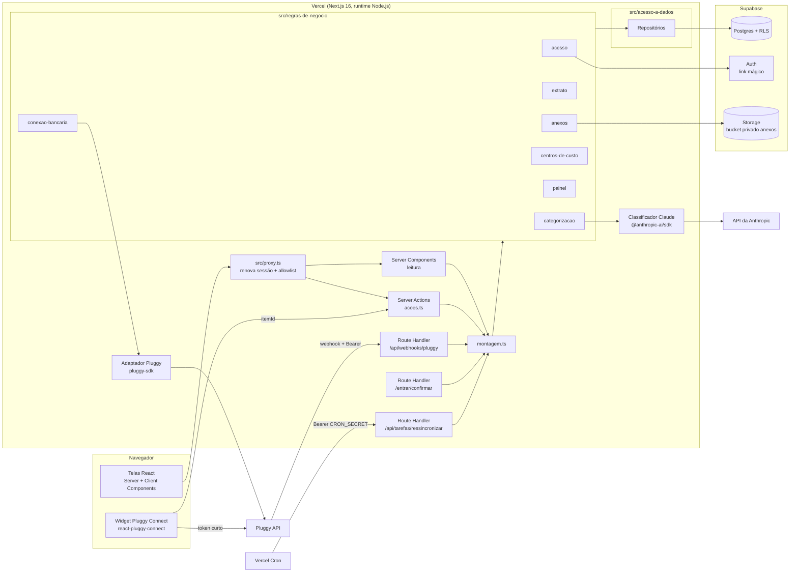
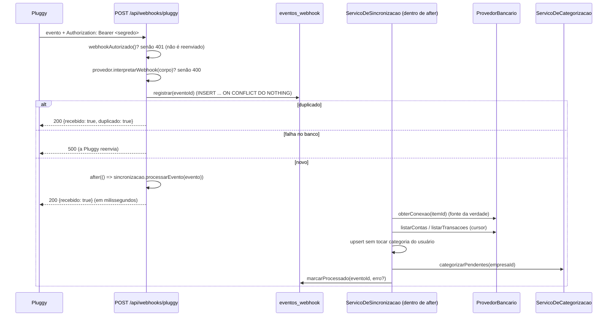
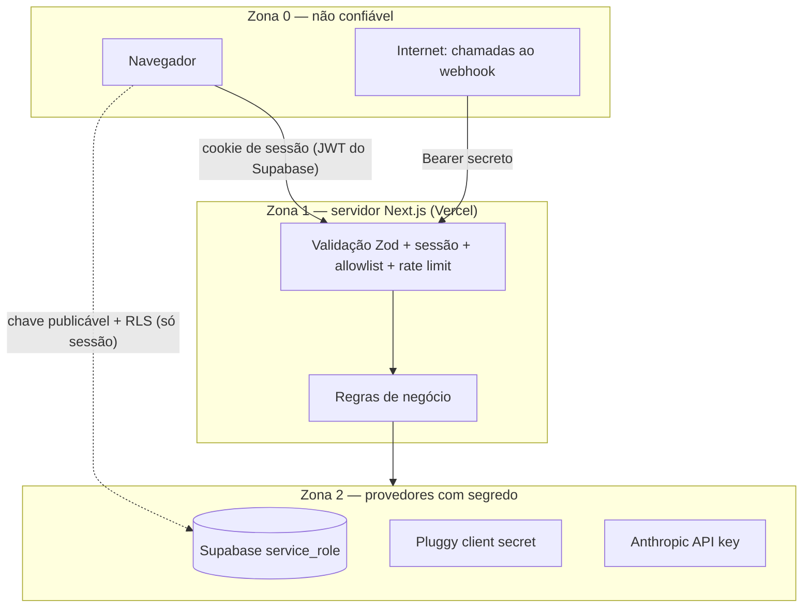

# Visão geral da arquitetura do Rastro

> Documentos relacionados: [glossário](glossario.md) · [modelo de dados](modelo-de-dados.md) · [contratos](contratos.md) · [estrutura de pastas](estrutura-de-pastas.md) · [decisões (ADRs)](decisoes/)

## 1. Estilo arquitetural

O Rastro é um **monólito modular** em Next.js 16 (App Router), hospedado na Vercel, com o Supabase como banco (Postgres + RLS), autenticação e arquivos. É um sistema para uma pessoa, desenvolvido por uma equipe pequena, então não cabe a operação de microsserviços. Os módulos têm fronteiras explícitas (contratos em [contratos.md](contratos.md)) e podem ser extraídos depois, se um dia for preciso.

Há três camadas, e a dependência só aponta para baixo:

| Camada | Pasta | Pode importar | Nunca importa |
|---|---|---|---|
| Interface | `src/app`, `src/componentes`, `src/identidade-visual` | `src/regras-de-negocio` (só o `index.ts` de cada módulo e `montagem.ts`), `src/ferramentas-internas` | `pluggy-sdk`, `@anthropic-ai/sdk`, `src/acesso-a-dados`, clientes do Supabase (exceção: `src/proxy.ts` e o callback de login usam `@supabase/ssr` para a sessão) |
| Regras de negócio | `src/regras-de-negocio/*` | contratos dos repositórios, adaptadores do próprio módulo, `src/configuracao`, `src/ferramentas-internas` | `next/*` (exceto `server-only`), componentes React |
| Acesso a dados e adaptadores | `src/acesso-a-dados`, `src/regras-de-negocio/*/adaptadores/` | Supabase, `pluggy-sdk`, `@anthropic-ai/sdk` | camada de interface |

O ESLint (`no-restricted-imports`) garante a regra: `pluggy-sdk` só pode ser importado em `src/regras-de-negocio/conexao-bancaria/adaptadores/**` e em `comandos/`, `@anthropic-ai/sdk` só em `src/regras-de-negocio/categorizacao/adaptadores/**`, e `@/acesso-a-dados` nunca é importado de `src/app/**`.

## 2. Módulos

| Módulo (`src/regras-de-negocio/…`) | Responsabilidade | Dono dos dados (escreve) | Expõe |
|---|---|---|---|
| `acesso` | Sessão, allowlist `EMAIL_AUTORIZADO`, empresa do usuário, rate limit | `empresas`, `membros_empresa`, `limites_de_requisicao` | `obterContextoDoUsuario`, `garantirEmpresa`, `consumirLimite` |
| `conexao-bancaria` | Adaptador `ProvedorBancario` (Pluggy), token do widget, registro e status das conexões, interpretação e autenticação do webhook | `conexoes`, `contas` | `ServicoDeConexaoBancaria`, `webhookAutorizado`, `ProvedorBancario` |
| `extrato` | Sincronização (eventos do webhook, ressincronização), consulta paginada com filtros | `transacoes` (dados vindos do banco), `eventos_webhook` | `ServicoDeSincronizacao`, `ServicoDeExtrato` |
| `categorizacao` | Estratégias (regras, mapeamento do provedor, IA), `Classificador` (Claude), correções que viram regra, CRUD de categorias e regras | `categorias`, `regras_categorizacao`, colunas de categoria em `transacoes` | `ServicoDeCategorizacao` |
| `centros-de-custo` | CRUD de centros de custo | `centros_de_custo` | `ServicoDeCentrosDeCusto` |
| `painel` | Agregações (fluxo mensal, por categoria, por centro de custo, saldo) | nenhum (só lê) | `ServicoDoPainel` |
| `anexos` | Upload e download (URL assinada) de notas e comprovantes | `anexos`, bucket `anexos` | `ServicoDeAnexos` |

`src/regras-de-negocio/montagem.ts` é a **raiz de composição**: o único lugar que instancia repositórios, adaptadores e serviços e liga uns aos outros (injeção de dependência manual, sem contêiner).

## 3. Fluxo principal



### 3.1 Conectar o banco

```mermaid
sequenceDiagram
  actor U as Usuário
  participant T as Tela /conexoes-bancarias
  participant A as Server Action iniciarConexao
  participant S as ServicoDeConexaoBancaria
  participant P as ProvedorBancario (Pluggy)
  participant DB as Postgres

  U->>T: "Conectar banco"
  T->>A: iniciarConexao()
  A->>S: iniciarConexao(ctx)
  S->>P: criarTokenDeConexao({identificadorDoUsuario: empresaId})
  P-->>S: {token}
  S-->>T: {token}  (sem webhookUrl, ver ADR 0007)
  T->>T: abre o widget; usuário autoriza no app do Sicredi
  T->>A: registrarConexao(itemId)
  A->>S: registrarConexao(ctx, itemId)
  S->>P: obterConexao(itemId)  (GET /items/{id})
  alt item não existe na aplicação (404) ou clientUserId ≠ empresaId
    S-->>T: erro "conexao_nao_encontrada"
  else ok
    S->>DB: upsert conexoes
    S-->>T: Conexao
  end
```

### 3.2 Webhook da Pluggy com `after()`



Regras do webhook (portadas do protótipo e do `CONTEXTO.md` §4):

1. **Autenticação** por `Authorization: Bearer <PLUGGY_WEBHOOK_SECRET>`, comparada com `crypto.timingSafeEqual`. A Pluggy não assina webhooks.
2. **Validação** do corpo com Zod. Payload inválido recebe 400, que a Pluggy não reenvia.
3. **Deduplicação** por `eventId` na tabela `eventos_webhook` (chave primária). O registro acontece **antes** do `after()`.
4. **Resposta 2XX em menos de 10 s**: o trabalho pesado fica no `after()`. O route handler declara `export const maxDuration = 60`.
5. **`GET /items/{id}` é a fonte da verdade** para status. O payload só diz "algo mudou".
6. **Falhas no `after()`** não geram reenvio (já respondemos 200). Por isso ficam em `eventos_webhook.erro` e no log, e a tarefa diária `/api/tarefas/ressincronizar` (Vercel Cron) cobre a perda. Ver ADR 0007.
7. **A empresa é descoberta pelo `itemId`**: `conexoes.id_externo` → `empresa_id`. Se o `item/created` chegar antes do `registrarConexao`, a empresa vem de `item.clientUserId`, que é o `empresaId` enviado no connect token, validado contra `empresas`.

Mapeamento de eventos (feito pelo adaptador):

| Evento Pluggy | `EventoDeWebhook.tipo` | Ação |
|---|---|---|
| `item/created` | `conexao_criada` | `obterConexao` → upsert da conexão; se `atualizada`, sincronização completa |
| `item/updated` | `conexao_atualizada` | `obterConexao` → atualiza status; sincroniza contas (saldo) e transações criadas desde `ultima_sincronizacao_em − 2 dias` (ou completa, se for a primeira) |
| `item/error` | `conexao_com_erro` | `obterConexao` para confirmar o status; grava `erro_codigo`/`erro_mensagem` |
| `transactions/created` | `transacoes_criadas` | `listarTransacoes(conta, {criadasDesde: transactionsCreatedAtFrom})` |
| `transactions/updated` | `transacoes_atualizadas` | `listarTransacoes(conta, {ids})` (lotes de até 500) |
| `transactions/deleted` | `transacoes_removidas` | `removerPorIdsExternos` |
| qualquer outro | `ignorado` | só registra |

## 4. Fronteiras de confiança



| Fronteira | Ameaça | Controle |
|---|---|---|
| Navegador → servidor | Usuário não autorizado, entrada maliciosa | `proxy.ts` (renova a sessão e confere a allowlist), **revalidação em cada Server Action e Route Handler** (`obterContextoDoUsuario()`), Zod em toda entrada, rate limit, CSP |
| Navegador → Supabase | Acesso direto às tabelas com a chave publicável | **RLS em todas as tabelas**. O app não usa o cliente do Supabase no navegador. Mesmo assim, se alguém usar a chave publicável, só vê os dados da própria empresa |
| Internet → webhook | Evento forjado ou repetido | Bearer secreto em tempo constante, Zod, deduplicação, `GET /items` como fonte da verdade |
| Internet → cron | Disparo indevido | `Authorization: Bearer <CRON_SECRET>` (padrão da Vercel Cron) |
| Servidor → Pluggy | Item de outra aplicação ou empresa | `obterConexao` (404 = não pertence à aplicação) e `clientUserId === empresaId` |
| Servidor → Anthropic | Vazamento de dados pessoais | Só `descricao`, `valor` e `contraparte`, sem ids, contas ou documentos (ADR 0004) |
| Servidor → Storage | Acesso a anexos de outra empresa | Bucket privado, caminho `{empresa_id}/…`, política de Storage por empresa, URL assinada de 60 s |

### 4.1 Onde ficam os segredos

| Variável | Onde existe | Quem lê |
|---|---|---|
| `NEXT_PUBLIC_SUPABASE_URL`, `NEXT_PUBLIC_SUPABASE_PUBLISHABLE_KEY` | Vercel + `.env.local` (públicas por definição) | `proxy.ts`, cliente do usuário |
| `SUPABASE_SERVICE_ROLE_KEY` | Vercel (Production/Preview) + `.env.local` | **só** `src/acesso-a-dados/supabase/cliente-do-sistema.ts` (webhook, cron, rate limit) |
| `PLUGGY_CLIENT_ID`, `PLUGGY_CLIENT_SECRET` | Vercel + `.env.local` | **só** o adaptador Pluggy e `comandos/registrar-webhook.ts` |
| `PLUGGY_WEBHOOK_SECRET` | Vercel + `.env.local` + cabeçalho registrado na Pluggy | route handler do webhook, `comandos/registrar-webhook.ts` |
| `ANTHROPIC_API_KEY` | Vercel + `.env.local` | **só** o adaptador Claude |
| `EMAIL_AUTORIZADO`, `CRON_SECRET` | Vercel + `.env.local` | `acesso`, rota de cron |
| `PLUGGY_INCLUIR_SANDBOX`, `URL_DO_SITE`, `RECURSO_*` | Vercel + `.env.local` (não são segredos) | configuração |

Todos são lidos em um único lugar, `src/configuracao/ambiente.ts`, que valida com Zod e começa com `import 'server-only'`. Nada de `NEXT_PUBLIC_` em segredo. Nenhum log inclui token, corpo de webhook, descrição de transação ou e-mail completo.

## 5. Contexto de execução e clientes do Supabase

| Situação | Cliente | RLS | Como obtém `empresaId` |
|---|---|---|---|
| Server Component, Server Action | `clienteDoUsuario()` (`@supabase/ssr`, cookies, chave publicável) | **aplicada** | `obterContextoDoUsuario()` → `membros_empresa` |
| Webhook, cron, rate limit | `clienteDoSistema()` (service role) | **ignorada**, então todo repositório **recebe e filtra `empresaId` explicitamente** | `conexoes.id_externo` → `empresa_id` |

Por isso todos os métodos de repositório recebem `empresaId` como parâmetro, mesmo quando a RLS já filtra. Essa é a defesa em profundidade do caminho com service role.

## 6. Categorização (resumo)

Uma corrente de estratégias (ADR 0003) é executada para as transações pendentes (`categoria_id IS NULL AND categorizacao_automatica_em IS NULL AND categoria_definida_pelo_usuario = false`):

1. `EstrategiaPorRegras`: regras da empresa por prioridade (`contém`, sem acento e sem diferença de maiúsculas).
2. `EstrategiaPorCategoriaDoProvedor`: mapeia categorias da Pluggy inequívocas (ex.: `Bank fees` → Tarifas bancárias).
3. `EstrategiaPorIa`: `Classificador` (Claude), em lotes de até 50; sugestão com `confianca < 0,6` não é aplicada.

O que sobrar fica "Sem categoria" para revisão. A correção feita pelo usuário marca `categoria_definida_pelo_usuario = true` (nenhuma sincronização sobrescreve) e devolve uma `SugestaoDeRegra`, que vira regra se o usuário aceitar.

## 7. Riscos e mitigação

| Risco | Impacto | Prob. | Mitigação |
|---|---|---|---|
| `after()` falha ou estoura o tempo depois do 200 | Transações faltando | Média | `eventos_webhook.erro`, cron diário de ressincronização, botão "Sincronizar agora" |
| Consentimento Open Finance expira (≈12 meses) | Sincronização para | Alta (anual) | `consentimento_expira_em` visível, aviso 15 dias antes, reconexão com `criarTokenDeConexao({idExternoParaReconectar})` |
| Caminho com service role esquece o filtro de empresa | Vazamento entre empresas | Baixa hoje, alta no SaaS | `empresaId` obrigatório na assinatura, teste de integração com duas empresas |
| Custo da IA disparar | Conta da Anthropic | Baixa | Só pendentes, lote de 50, `categorizacao_automatica_em` evita reenvio, flag `RECURSO_CATEGORIZACAO_IA` desliga |
| Supabase Free pausa por inatividade | App fora do ar | Média | O cron diário mantém atividade. Plano pago no go-live comercial |
| Uso comercial no Vercel Hobby | Violação dos termos | Alta no go-live | ADR 0012: migrar para o Pro antes de conectar a conta real |
